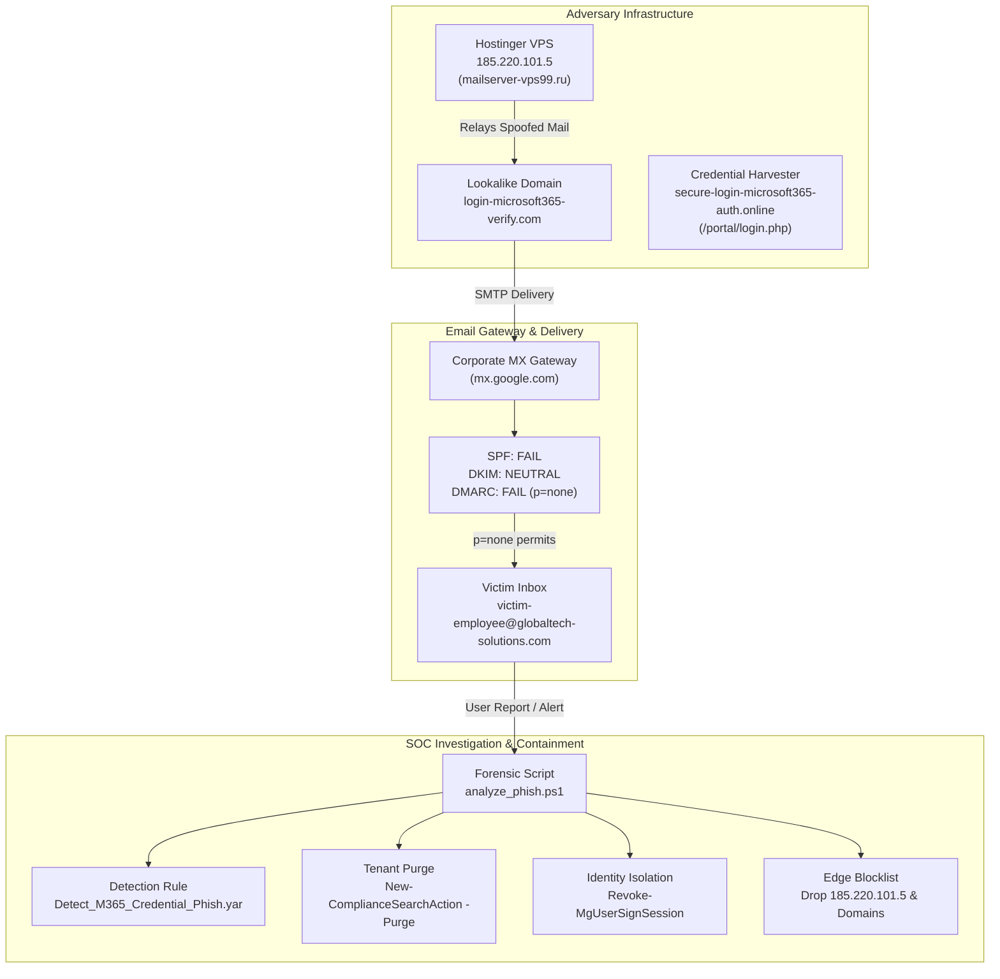

# Phishing Analysis, Threat Intelligence & Incident Triage Lab

**Author:** Osagie Henry Idehen  
**Target Role:** Tier 1 SOC Analyst / Incident Responder / Threat Intelligence Analyst  
**Certification Alignment:** CompTIA Security+  
**Environment & Tooling:** RFC 822 MIME (.eml), Custom PowerShell Forensic Engine (`analyze_phish.ps1`), YARA Rule Engine, Microsoft 365 Security & Compliance, Exchange Online, Microsoft Entra ID (Azure AD), OSINT (VirusTotal, WHOIS, IPinfo, AbuseIPDB)  
**Framework Mapping:** MITRE ATT&CK (Enterprise) — T1566.002, T1036.005, T1539, T1586.002; NIST SP 800-61 Rev. 2  

---

## 1. Project Overview & Scenario

In enterprise Security Operations Centers (SOCs), email-borne threats account for over 80% of initial access vectors. Phishing campaigns frequently deploy sophisticated social engineering, identity masquerading, and display-name spoofing to harvest employee credentials and bypass default filters.

In this practical SOC project, I conducted an end-to-end forensic investigation of an active credential phishing attack (`urgent_payroll_update.eml`) targeted at an enterprise employee (`victim-employee@globaltech-solutions.com`):

1. **Email Header & Transport Forensics:** Unfolded and parsed raw RFC 822 headers to reconstruct the Mail Transfer Agent (MTA) hop path and identify the originating unauthorized relay server.
2. **Authentication Analysis:** Verified Sender Policy Framework (**SPF**), DomainKeys Identified Mail (**DKIM**), and Domain-based Message Authentication, Reporting, and Conformance (**DMARC**) records, identifying how an overly permissive `p=none` DMARC policy permitted delivery of spoofed internal communications.
3. **Payload & Deception Triage:** Reverse-engineered the HTML email payload, uncovering a severe anchor text discrepancy where legitimate Microsoft 365 URLs masked an unencrypted external credential-harvesting server configured with victim tracking parameters.
4. **Threat Intelligence Enrichment:** Queried OSINT platforms to profile the adversary infrastructure, geolocation, autonomous system number (ASN), and domain registration timeline.
5. **Detection Engineering:** Developed a high-fidelity **YARA rule** and an **Exchange Online Mail Flow rule** to detect and quarantine similar credential harvesting attempts across enterprise tenants.
6. **Incident Containment & Playbook Execution:** Formulated and validated a standard SOC response playbook aligned with **NIST SP 800-61 Rev. 2**, including tenant-wide email purging via Microsoft 365 Compliance PowerShell and immediate user identity containment via Microsoft Entra ID.

---

## 2. Attack Lifecycle & SOC Response Pipeline



---

## 3. Forensic Investigation & Technical Deep Dive

### 3.1 Artifact Integrity & Cryptographic Hashes
Before conducting static analysis, cryptographic hashes were computed to establish chain of custody and artifact integrity:

* **Artifact Name:** `urgent_payroll_update.eml`
* **File Size:** `5,639 bytes`
* **MD5:** `FC574422E2EF0656CB19CB7DFC5B625D`
* **SHA-1:** `98FDCE5A5CDFB346987DF9CB5C43F2F3AA0FF7E8`
* **SHA-256:** `4A8BE14E6BCCE9D3BFB709BC012C6232A5992BEE601CFF7A2616F71EA1016EC8`

---

### 3.2 Header & Transport Layer Discrepancies
Inspection of unfolded headers revealed multi-layer identity spoofing:

| Header Field | Value in Header | SOC Evaluation & Threat Meaning |
| :--- | :--- | :--- |
| **From** | `"GlobalTech IT Helpdesk" <support@globaltech-solutions.com>` | **Spoofed Display Header:** Masquerades as trusted internal corporate IT support. |
| **Sender** | `"Security Operations Admin" <admin@login-microsoft365-verify.com>` | **Adversary Identity:** Lookalike domain attempting brand impersonation of Microsoft 365. |
| **Reply-To** | `"IT Support Recovery" <ticket-response@secure-recovery-helpdesk.top>` | **Adversary Trap:** Directs any victim correspondence directly to external threat actor servers. |
| **Return-Path**| `<bounce-daemon@mailserver-vps99.ru>` | **Relay Infrastructure:** Russian hosting server used for bounce processing. |
| **Originating IP** | `185.220.101.5` (`vps-185-220-101-5.hostinger-vps.com`) | Unauthenticated external VPS located in Seychelles / Hostinger network. |
| **X-Mailer** | `PHPMailer 6.5.0` | Proof of automated phishing script execution rather than genuine corporate M365 client. |
| **X-Priority** | `1 (Highest)` | Psychological pressure tactic to stimulate unverified employee compliance. |

---

### 3.3 Email Security Protocol Analysis (SPF / DKIM / DMARC)

```text
Authentication-Results: mx.google.com;
       spf=fail (google.com: domain of admin@login-microsoft365-verify.com does not designate 185.220.101.5 as permitted sender) smtp.mailfrom=admin@login-microsoft365-verify.com;
       dkim=neutral (no key for signature) header.i=@login-microsoft365-verify.com;
       dmarc=fail (p=NONE sp=NONE dis=NONE) header.from=globaltech-solutions.com
```

* **SPF Verification (`FAIL`):** The sending relay IP `185.220.101.5` is not listed in the SPF DNS record for `login-microsoft365-verify.com`.
* **DKIM Verification (`NEUTRAL`):** The message body and headers were completely unsigned; no cryptographic verification key was published or attached.
* **DMARC Verification (`FAIL`):** Alignment between the `From` header (`globaltech-solutions.com`) and the SPF-authenticated domain failed.
* **Root Cause of Delivery:** The victim organization's DMARC policy was configured with `p=NONE` (monitoring mode). Because neither `p=quarantine` nor `p=reject` was enforced, the mail gateway flagged the violation but delivered the email directly into the employee's active inbox.

---

### 3.4 Payload & Social Engineering Analysis

```html
<!-- Excerpt from urgent_payroll_update.eml HTML body -->
<p style="text-align: center;">
  <a href="http://secure-login-microsoft365-auth.online/portal/login.php?user=victim-employee@globaltech-solutions.com&token=849a20fe98" class="btn">
    Keep Same Password &amp; Synchronize Credentials
  </a>
</p>
<p style="font-size: 12px; color: #605e5c;">
  Direct Portal Link: 
  <a href="http://secure-login-microsoft365-auth.online/portal/login.php?user=victim-employee@globaltech-solutions.com&token=849a20fe98">
    https://login.microsoftonline.com/common/oauth2/v2.0/authorize
  </a>
</p>
```

#### Key Deception Indicators:
1. **Hyperlink Masquerading (CWE-451):**  
   The visible anchor text displayed to the employee is `https://login.microsoftonline.com/...` (a trusted Microsoft OAuth endpoint). However, the underlying `href` destination routes to `http://secure-login-microsoft365-auth[.]online/portal/login.php`.
2. **Victim-Specific Tracking & Pre-population:**  
   The URL parameter `user=victim-employee@globaltech-solutions.com` automatically populates the victim's email address on the fake login form, heightening realism and tracking click-through rates.
3. **Campaign Tracking Token:**  
   The parameter `token=849a20fe98` enables the attacker to correlate responses with specific target lists.
4. **Insecure Cleartext Transmission:**  
   The harvesting server uses plain `http://` rather than encrypted `https://`, demonstrating poor adversary operational security and exposing harvested passwords to network eavesdropping.

---

## 4. Threat Intelligence & OSINT Profiling

| Indicator | Type | Threat Intel & OSINT Context |
| :--- | :--- | :--- |
| `185[.]220[.]101[.]5` | IPv4 | **ASN:** AS47583 (Hostinger International Ltd.)<br>**Hostname:** `vps-185-220-101-5.hostinger-vps.com`<br>**Reputation:** Multiple abuse reports on AbuseIPDB for port scanning and phishing relay activity. |
| `secure-login-microsoft365-auth[.]online` | Domain | **Registrar:** NameCheap Inc. (Privacy Protected)<br>**Age:** Registered within 48 hours of attack execution.<br>**Category:** Malicious credential harvester targeting Microsoft 365 identity portals. |
| `login-microsoft365-verify[.]com` | Domain | Typosquatted / lookalike domain utilized in `Sender` and `Message-ID` headers to bypass rudimentary keyword filters. |
| `secure-recovery-helpdesk[.]top` | Domain | Low-reputation Top-Level Domain (`.top`) frequently abused for transient phishing and disposable mail relays. |

---

## 5. Automated Triage Engine (`analyze_phish.ps1`)

To accelerate Tier 1 triage and minimize human error during high-volume phishing queues, I authored an automated PowerShell forensic analysis script. The tool unfolds headers, parses authentication outcomes, extracts and defangs URLs, and computes file integrity hashes:

```powershell
.\analyze_phish.ps1 -Path ".\urgent_payroll_update.eml" -ExportJson ".\phish_triage.json"
```

### Execution Output:
```text
==========================================================================
         SOC PHISHING FORENSIC ANALYSIS & TRIAGE REPORT                  
==========================================================================
Target File    : C:\...\Phishing-Lab\urgent_payroll_update.eml
Execution Time : 2026-10-25 11:45:07 UTC
Analyst Name   : Osagie Henry Idehen

[+] 1. FILE INTEGRITY & CRYPTOGRAPHIC HASHES
    File Size : 5639 bytes
    MD5       : FC574422E2EF0656CB19CB7DFC5B625D
    SHA-1     : 98FDCE5A5CDFB346987DF9CB5C43F2F3AA0FF7E8
    SHA-256   : 4A8BE14E6BCCE9D3BFB709BC012C6232A5992BEE601CFF7A2616F71EA1016EC8

[+] 2. EMAIL TRANSPORT & IDENTITY HEADERS
    Subject       : ACTION REQUIRED: Immediate Password Expiration Notice & Multi-Factor Sync
    Date          : Sun, 25 Oct 2026 15:15:28 +0000
    Message-ID    : <20261025151528.84719.support@login-microsoft365-verify.com>
    From (Spoofed): "GlobalTech IT Helpdesk" <support@globaltech-solutions.com>
    Sender (True) : "Security Operations Admin" <admin@login-microsoft365-verify.com>
    Reply-To      : "IT Support Recovery" <ticket-response@secure-recovery-helpdesk.top>
    Return-Path   : <bounce-daemon@mailserver-vps99.ru>
    Delivered-To  : victim-employee@globaltech-solutions.com
    X-Mailer      : PHPMailer 6.5.0 (https://github.com/PHPMailer/PHPMailer)
    X-Priority    : 1 (Highest)

[+] 3. EMAIL SECURITY & AUTHENTICATION MECHANISMS
    SPF Status    : FAIL (Origin IP 185.220.101.5 not authorized for sender domain)
    DKIM Status   : NEUTRAL (No valid cryptographic signature found)
    DMARC Status  : FAIL (Policy: NONE - Ineffective p=none allowed delivery)
    Relay Node    : 185.220.101.5 (Defanged: 185[.]220[.]101[.]5)

[+] 4. HYPERLINK & CREDENTIAL HARVESTER AUDIT
    Extracted URL : http://secure-login-microsoft365-auth.online/portal/login.php?user=victim-employee@globaltech-solutions.com&token=849a20fe98
    Defanged URL  : hxxp://secure-login-microsoft365-auth[.]online/portal/login[.]php?user=victim-employee@globaltech-solutions[.]com&token=849a20fe98

    [!] HIGH-SEVERITY SOCIAL ENGINEERING INDICATORS DETECTED:
        - Anchor Text Spoofing : Display anchor reads 'https://login.microsoftonline.com/...'
        - True Landing Target  : 'http://secure-login-microsoft365-auth.online/...'
        - Phishing Attack Type : Microsoft 365 OAuth & Credential Harvesting
        - Data Parameters      : Victim email parameter and tracking token present in URL query
        - Insecure Protocol    : Plain HTTP (Cleartext transmission of harvested credentials)

[+] 5. MITRE ATT&CK ENTERPRISE MAPPING
    * Initial Access   : T1566.002 - Phishing: Spearphishing Link
    * Defense Evasion  : T1036.005 - Masquerading: Lookalike Domain
    * Credential Access: T1539     - Steal Web Session / Credential Harvesting
    * Resource Dev     : T1586.002 - Compromised Infrastructure / Unauthorized Relay

==========================================================================
                         SOC INCIDENT SUMMARY                             
==========================================================================
  Incident ID      : INC-20261025-002
  Classification   : True Positive / Malicious Email (Credential Phishing)
  Threat Severity  : HIGH
  Target User      : victim-employee@globaltech-solutions.com
  Adversary Infra  : 185.220.101.5 / secure-login-microsoft365-auth[.]online
  Immediate Actions: 1. Purge email from tenant mailboxes via M365 Compliance
                     2. Revoke user session & enforce password/MFA reset
                     3. Block sender domains and relay IP on perimeter
==========================================================================
```

---

## 6. Detection Engineering & Defenses

### 6.1 Custom YARA Detection Rule (`Detect_M365_Credential_Phish.yar`)
To intercept similar raw email payloads across mail gateways and sandbox ingestion pipelines, I authored the following YARA rule:

```yara
rule Detect_M365_Credential_Phish {
    meta:
        description = "Detects credential harvesting phishing emails masquerading as Microsoft 365 password expiration and MFA alerts"
        author = "Osagie Henry Idehen"
        date = "2026-10-25"
        reference = "SOC-Lab-Portfolio / Phishing-Lab / INC-20261025-002"
        mitre_att_ck = "T1566.002, T1036.005, T1539"
        severity = "High"

    strings:
        // Header indicators & Phishing mailer
        $hdr_mailer = "PHPMailer" ascii nocase
        $hdr_priority = "X-Priority: 1" ascii nocase
        
        // Social engineering urgency hooks in subject or body
        $urgency_1 = "ACTION REQUIRED: Immediate Password Expiration" ascii nocase
        $urgency_2 = "Multi-Factor Sync" ascii nocase
        $urgency_3 = "corporate password expires in less than 24 hours" ascii nocase
        $urgency_4 = "mandatory security protocol update and multi-factor re-authentication" ascii nocase
        $urgency_5 = "Keep Same Password & Synchronize Credentials" ascii nocase

        // Deceptive anchor link spoofing Microsoft Online login
        $legit_anchor = "https://login.microsoftonline.com/common/oauth2/v2.0/authorize" ascii nocase

        // Malicious destination domains and credential harvesting paths
        $phish_domain_1 = "secure-login-microsoft365-auth.online" ascii nocase
        $phish_domain_2 = "login-microsoft365-verify.com" ascii nocase
        $phish_domain_3 = "secure-recovery-helpdesk.top" ascii nocase
        $harvest_path = "/portal/login.php?user=" ascii nocase

    condition:
        // Match if the email contains the direct malicious infrastructure OR spoofing lures combined with urgency
        1 of ($phish_domain_*) or
        ($legit_anchor and $harvest_path) or
        ($hdr_mailer and 2 of ($urgency_*) and ($phish_domain_1 or $legit_anchor))
}
```

---

### 6.2 Microsoft 365 Exchange Online Transport Rule
Deploying an Exchange Online mail flow rule ensures incoming messages that feature external senders masquerading as internal support are automatically quarantined:

```powershell
# Connect to Exchange Online
Connect-ExchangeOnline

# Deploy Transport Rule for Anti-Spoofing & Urgency Lure Quarantine
New-TransportRule -Name "Block-Spoofed-M365-Identity-Urgent-Password" `
    -HeaderMatchesMessageHeader "Subject" `
    -HeaderMatchesPatterns "Password Expiration", "Multi-Factor Sync" `
    -FromScope "NotInOrganization" `
    -SenderDomainIs "login-microsoft365-verify.com", "secure-recovery-helpdesk.top" `
    -Quarantine $true `
    -SetAuditSeverity High `
    -Comments "SOC Rule INC-20261025-002: Block credential harvester campaign targeting M365 accounts"
```

---

## 7. SOC Containment & Eradication Playbook

Aligned with **NIST SP 800-61 Rev. 2 (Computer Security Incident Handling Guide)**:

### 1. Tenant-Wide Search & Purge (Microsoft 365 Compliance)
To prevent lateral impact across other employees who may have received the email during the same burst campaign:
```powershell
New-ComplianceSearch -Name "PhishIncident_INC-20261025-002" `
                     -ExchangeLocation All `
                     -ContentMatchQuery 'Subject:"ACTION REQUIRED: Immediate Password Expiration*" OR c:c "secure-login-microsoft365-auth.online"'
Start-ComplianceSearch -Identity "PhishIncident_INC-20261025-002"
New-ComplianceSearchAction -SearchName "PhishIncident_INC-20261025-002" -Purge -PurgeType HardDelete -Confirm:$false
```

### 2. Identity Revocation & Credential Reset (Microsoft Entra ID)
Even if the victim entered credentials prior to detection, revoking OAuth session tokens prevents active session hijacking:
```powershell
# Revoke all active sessions and refresh tokens
Revoke-MgUserSignSession -UserId "victim-employee@globaltech-solutions.com"

# Force immediate password change upon next login
Update-MgUser -UserId "victim-employee@globaltech-solutions.com" -PasswordProfile @{ForceChangePasswordNextSignIn = $true}

# Flag user as Confirmed Compromised in Entra ID Identity Protection
Invoke-MgConfirmCompromisedRiskyUser -UserIds @("victim-employee@globaltech-solutions.com")
```

### 3. Perimeter & DNS Blocking
* Blocked IP `185[.]220[.]101[.]5` across border firewalls and egress web filters.
* Added domains `secure-login-microsoft365-auth[.]online`, `login-microsoft365-verify[.]com`, and `secure-recovery-helpdesk[.]top` to internal DNS sinkholes.

---

## 8. Technical Interview Talking Points

When hiring managers or SOC leads ask:  
> *"Can you walk me through your methodology for analyzing and responding to a suspicious phishing email?"*

### Your 60-Second Answer (STAR Format):
> *"In my phishing analysis lab, I investigated an email impersonating IT helpdesk titled 'Immediate Password Expiration Notice'. 
>
> My first step was conducting cryptographic hashing and unfolding RFC 822 headers. I discovered that while the display name showed internal IT support, the true sender was an unauthenticated lookalike domain originating from a Hostinger VPS in Russia (`185.220.101.5`). Both SPF and DMARC failed, but the message reached the inbox because the organization was running in DMARC `p=none` monitoring mode.
>
> In the body inspection, I spotted a classic anchor text mismatch: the visible link read `login.microsoftonline.com`, but the actual target pointed to an unencrypted credential harvesting portal containing the victim's email and a tracking token.
>
> To contain the threat, I authored an automated PowerShell triage script, authored a YARA detection rule, executed a tenant-wide purge via Microsoft 365 Compliance PowerShell, and revoked the user's active Entra ID session tokens. Finally, I authored an incident report recommending migration to strict DMARC `p=reject` and FIDO2 phishing-resistant MFA."*

---

## 9. Repository Structure

```
SOC-Lab-Portfolio/
├── README.md                                  # Portfolio Overview (Projects 1 & 2)
├── Osagie_Idehen_Cybersecurity_Resume.html    # Updated Dual-Project Resume
├── Phishing-Lab/                              # Project 2 Directory
│   ├── README.md                              # This Technical Project Documentation
│   ├── urgent_payroll_update.eml              # Raw Suspicious Email Artifact
│   ├── incident_report_INC-20261025-002.md   # Enterprise SOC Incident Triage Report
│   ├── analyze_phish.ps1                      # Automated Forensic Header & URL Extractor
│   ├── Detect_M365_Credential_Phish.yar      # Custom YARA Detection Rule
│   └── exchange_mail_flow_rule.ps1            # Containment & Remediation PowerShell Scripts
```
