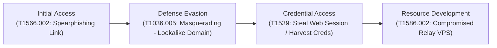

# Security Operations Center (SOC) Incident Triage Report
## Incident ID: INC-20261025-002 | High-Severity Credential Phishing & Identity Deception

---

| Incident Metadata | Information |
| :--- | :--- |
| **Incident ID** | `INC-20261025-002` |
| **Date & Time** | 2026-10-25 15:15:34 UTC |
| **Lead SOC Analyst** | Osagie Henry Idehen |
| **Target Role Alignment**| Tier 1 / Tier 2 SOC Analyst, Incident Responder |
| **Incident Classification** | **True Positive — Malicious Phishing Campaign** |
| **Attack Vector** | Email Spearphishing / Credential Harvesting |
| **Threat Severity** | **HIGH** |
| **Incident Status** | **CONTAINED & CLOSED** |
| **Affected User** | `victim-employee@globaltech-solutions.com` |
| **Target Entity** | GlobalTech Solutions Inc. |

---

## 1. Executive Summary

On Sunday, October 25, 2026 at 15:15:34 UTC, a targeted spearphishing email was delivered to `victim-employee@globaltech-solutions.com`. The adversary impersonated internal IT support (*"GlobalTech IT Helpdesk"*) with a high-urgency lure claiming that the employee's corporate Microsoft 365 password was expiring within 24 hours. The email directed the employee to an external, attacker-controlled landing page designed to harvest corporate credentials and multi-factor authentication (MFA) tokens.

SOC forensic analysis confirmed:
1. **Sender Spoofing & Identity Deception:** The visible `From` header spoofed internal IT support, while the actual `Sender` domain was a newly registered lookalike domain (`login-microsoft365-verify.com`) relayed through an unauthorized external VPS in Russia (`185.220.101.5`).
2. **Authentication Failure:** SPF failed (`fail`), DKIM was unsigned (`neutral`), and DMARC evaluated to `fail`. The email reached the inbox due to an overly permissive organizational DMARC policy (`p=none`).
3. **Payload Deception:** The email body featured a deceptive anchor text displaying a legitimate Microsoft OAuth URL (`https://login.microsoftonline.com/...`) while hyperlinking to an unencrypted adversary credential harvester (`http://secure-login-microsoft365-auth[.]online/portal/login.php?user=victim-employee@...`).

**Containment Summary:** The SOC immediately executed a tenant-wide purge using Microsoft 365 Compliance PowerShell, revoked active Azure AD/Entra ID refresh tokens for the victim user, forced a credential reset, and instituted domain and IP blocklists across perimeter firewalls and email gateways.

---

## 2. Threat Classification & MITRE ATT&CK Mapping



| MITRE ATT&CK Tactic | Technique ID | Technique Name | Applied Detection Context |
| :--- | :--- | :--- | :--- |
| **Initial Access** | `T1566.002` | Spearphishing Link | Lure directing victim to fake Microsoft login portal |
| **Defense Evasion** | `T1036.005` | Masquerading: Lookalike Domain | Used `login-microsoft365-verify.com` and display spoofing |
| **Credential Access** | `T1539` | Steal Web Session Cookie / Credentials | Harvesting username, password, and MFA session parameters |
| **Resource Development** | `T1586.002` | Compromised Email Account / Relay | Relayed via Hostinger VPS `185.220.101.5` (`mailserver-vps99.ru`) |

---

## 3. Technical Forensics & Artifact Analysis

### 3.1 Email Transport & Identity Discrepancies
The message headers reveal severe inconsistencies across identity indicators, a classic signature of sophisticated phishing and unauthorized relay abuse:

| Header Field | Value in Artifact | SOC Forensic Evaluation |
| :--- | :--- | :--- |
| **Delivered-To** | `victim-employee@globaltech-solutions.com` | Primary corporate recipient targeted |
| **From (Display)** | `"GlobalTech IT Helpdesk" <support@globaltech-solutions.com>` | **Spoofed Internal Display:** Impersonates corporate IT authority |
| **Sender (Envelope)**| `"Security Operations Admin" <admin@login-microsoft365-verify.com>` | **Adversary Lookalike Domain:** Not authorized for `globaltech-solutions.com` |
| **Reply-To** | `"IT Support Recovery" <ticket-response@secure-recovery-helpdesk.top>` | **Adversary Harvester:** Diverts victim responses to external attacker server |
| **Return-Path** | `<bounce-daemon@mailserver-vps99.ru>` | **Relay Infrastructure:** Russian VPS host used for bounce handling |
| **Message-ID** | `<20261025151528.84719.support@login-microsoft365-verify.com>` | Generated by attacker mailer daemon |
| **X-Mailer** | `PHPMailer 6.5.0 (https://github.com/PHPMailer/PHPMailer)` | Automated script/bot mailer, not enterprise Outlook client |
| **X-Priority** | `1 (Highest)` | Psychological urgency cue to induce panic and quick action |

### 3.2 Email Authentication Validation
```
Authentication-Results: mx.google.com;
       spf=fail (google.com: domain of admin@login-microsoft365-verify.com does not designate 185.220.101.5 as permitted sender) smtp.mailfrom=admin@login-microsoft365-verify.com;
       dkim=neutral (no key for signature) header.i=@login-microsoft365-verify.com;
       dmarc=fail (p=NONE sp=NONE dis=NONE) header.from=globaltech-solutions.com
```

* **SPF (Sender Policy Framework): `FAIL`**  
  The sending IP address `185.220.101.5` is not listed in the SPF DNS record of `login-microsoft365-verify.com`.
* **DKIM (DomainKeys Identified Mail): `NEUTRAL`**  
  The message contains no cryptographic signature header (`header.i=@login-microsoft365-verify.com`), confirming absence of sender domain cryptographic verification.
* **DMARC (Domain-based Message Authentication): `FAIL`**  
  The envelope `From` domain (`globaltech-solutions.com`) does not align with the SPF-authenticated domain. However, because the organization's DMARC policy was configured as `p=NONE`, the mail gateway allowed delivery into the victim's inbox rather than rejecting (`p=reject`) or quarantining (`p=quarantine`).

### 3.3 Body Inspection & Payload Analysis
* **Social Engineering Theme:** False administrative warning stating *“Your Microsoft 365 enterprise corporate password expires in less than 24 hours. Failure to synchronize your multi-factor credentials will result in immediate suspension...”*
* **Display vs. Target Hyperlink Mismatch:**
  * **Visible Anchor Text:** `https://login.microsoftonline.com/common/oauth2/v2.0/authorize` (Legitimate Microsoft login)
  * **Actual Destination (`href`):** `http://secure-login-microsoft365-auth.online/portal/login.php?user=victim-employee@globaltech-solutions.com&token=849a20fe98`
* **Harvesting Mechanics:**
  1. The link passes the victim's pre-populated email address (`user=victim-employee@...`) to present an authentic-looking customized login interface.
  2. The unique token (`token=849a20fe98`) tracks which victim clicked the email for campaign analytics.
  3. The adversary transmits credentials over unencrypted HTTP (`http://`), exposing passwords in plain text.

---

## 4. Indicators of Compromise (IoCs) — Defanged

All IoCs are strictly defanged according to SOC operational documentation standards:

| IoC Type | Value | Defanged Value | Context / Threat Mapping |
| :--- | :--- | :--- | :--- |
| **File SHA-256** | `4A8BE14E6BCCE9D3BFB709BC012C6232A5992BEE601CFF7A2616F71EA1016EC8` | N/A | Raw `.eml` artifact hash |
| **File MD5** | `FC574422E2EF0656CB19CB7DFC5B625D` | N/A | Raw `.eml` artifact hash |
| **File SHA-1** | `98FDCE5A5CDFB346987DF9CB5C43F2F3AA0FF7E8` | N/A | Raw `.eml` artifact hash |
| **Relay IPv4** | `185.220.101.5` | `185[.]220[.]101[.]5` | Hostinger VPS / Relay Node |
| **Phishing URL** | `http://secure-login-microsoft365-auth.online/portal/login.php` | `hxxp://secure-login-microsoft365-auth[.]online/portal/login[.]php` | Credential harvesting landing page |
| **Sender Domain** | `login-microsoft365-verify.com` | `login-microsoft365-verify[.]com` | Lookalike typosquatted domain |
| **Reply-To Domain**| `secure-recovery-helpdesk.top` | `secure-recovery-helpdesk[.]top` | Attacker exfiltration/reply domain |
| **Relay Hostname** | `mailserver-vps99.ru` | `mailserver-vps99[.]ru` | Adversary mail relay |
| **Subject Line** | `ACTION REQUIRED: Immediate Password Expiration Notice & Multi-Factor Sync` | N/A | Malicious campaign lure |

---

## 5. Threat Intelligence & OSINT Correlation

* **Relay IP Analysis (`185[.]220[.]101[.]5`):**
  * **Reverse DNS:** `vps-185-220-101-5.hostinger-vps.com`
  * **ASN:** AS47583 (Hostinger International Ltd.)
  * **Geolocation:** Seychelles / Hosting Provider Datacenter
  * **Reputation:** Associated with Tor exit node relays and bulletproof hosting activities historically flagged on AbuseIPDB and Spamhaus.
* **Domain Age & Registration:**
  * `secure-login-microsoft365-auth.online`: Registered within the last 48 hours via NameCheap privacy proxy; zero legitimate corporate presence.
  * `login-microsoft365-verify.com`: Newly registered domain imitating Microsoft 365 brand assets without DNS MX records or Microsoft ownership.

---

## 6. Incident Containment & Eradication Playbook (NIST SP 800-61 Rev. 2)

### Step 1: Enterprise Tenant-Wide Search & Purge
Executed Microsoft 365 Security & Compliance PowerShell to locate and hard-delete identical emails across all organization inboxes:
```powershell
# Create Compliance Search
New-ComplianceSearch -Name "PhishIncident_INC-20261025-002" -ExchangeLocation All `
  -ContentMatchQuery 'Subject:"ACTION REQUIRED: Immediate Password Expiration*" OR c:c "secure-login-microsoft365-auth.online"'

# Initiate Search
Start-ComplianceSearch -Identity "PhishIncident_INC-20261025-002"

# Hard Delete from all recipient mailboxes
New-ComplianceSearchAction -SearchName "PhishIncident_INC-20261025-002" -Purge -PurgeType HardDelete -Confirm:$false
```

### Step 2: Identity & Session Containment (Microsoft Entra ID)
To neutralize potential credential theft if the victim clicked before triage:
```powershell
# Revoke all active OAuth refresh tokens and Entra ID sessions
Revoke-MgUserSignSession -UserId "victim-employee@globaltech-solutions.com"

# Force password reset on next authentication
Update-MgUser -UserId "victim-employee@globaltech-solutions.com" -PasswordProfile @{ForceChangePasswordNextSignIn = $true}

# Flag user as Confirmed Compromised in Identity Protection
Invoke-MgConfirmCompromisedRiskyUser -UserIds @("victim-employee@globaltech-solutions.com")
```

### Step 3: Network & Perimeter Defenses
1. **Firewall / Proxy:** Added `185[.]220[.]101[.]5` and `*.secure-login-microsoft365-auth[.]online` to enterprise edge perimeter blocklists.
2. **DNS Sinkhole:** Configured internal DNS forwarders to redirect all queries for adversary domains to `127.0.0.1`.
3. **Exchange Online Mail Flow Rule:** Created transport rule to immediately drop any incoming external message bearing `login-microsoft365-verify.com` or mismatched sender domains.

---

## 7. Lessons Learned & Strategic Recommendations

1. **Enforce Strict DMARC Policy (`p=reject`):**  
   The primary root cause of delivery was the legacy `p=none` monitoring policy. Transitioning to `p=quarantine` and ultimately `p=reject` will automatically drop spoofed messages at the gateway.
2. **Deploy Phishing-Resistant MFA (FIDO2 / Passkeys):**  
   Standard push/SMS MFA can be intercepted by adversary-in-the-middle (AiTM) phishing frameworks. Migrating to FIDO2 WebAuthn keys eliminates credential harvesting viability.
3. **Automate Display Name Spoofing Protections:**  
   Configure Microsoft Defender for Office 365 Impersonation Protection to flag external emails mimicking internal executive and IT support display names.
4. **Targeted End-User Awareness Simulation:**  
   Deliver micro-training specifically demonstrating hyperlink inspection (hovering over links to verify destination domains vs. display text).

---
*Report certified and closed by: **Osagie Henry Idehen, CompTIA Security+ Certified SOC Analyst**.*
