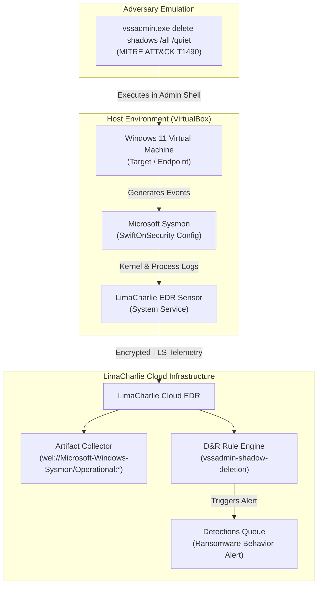
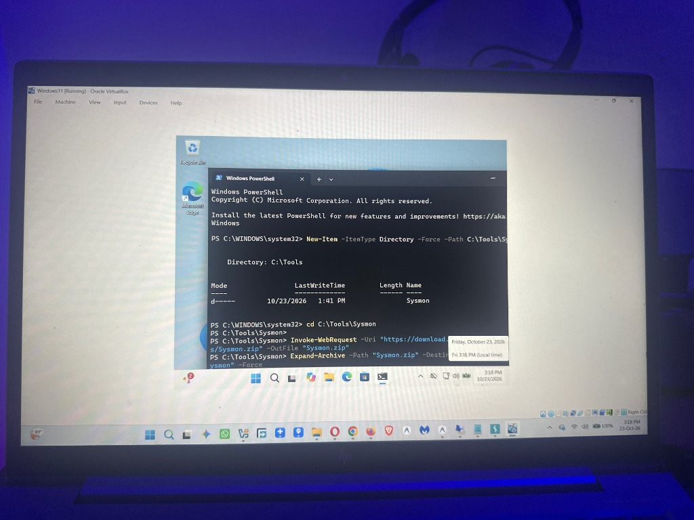
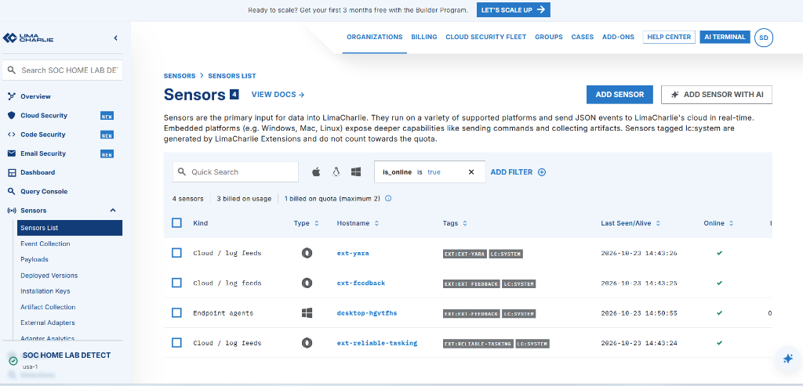
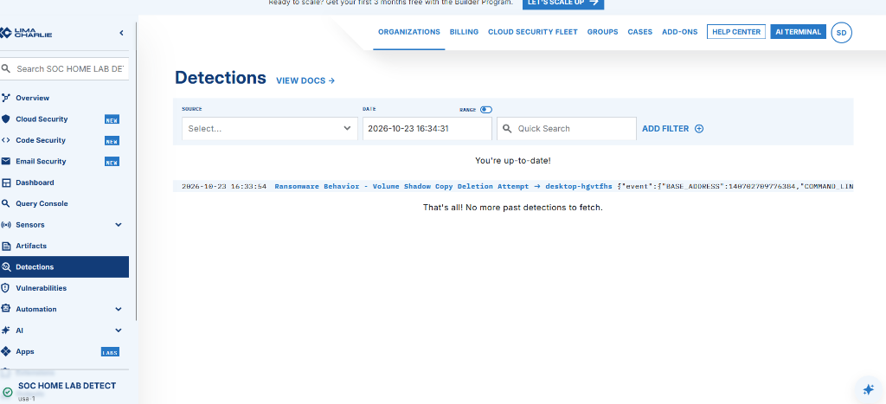

# Enterprise SOC Analyst & Detection Engineering Portfolio

**Author:** Osagie Henry Idehen  
**Target Roles:** Tier 1 / Tier 2 SOC Analyst • Detection Engineer • Incident Responder  
**Certifications:** CompTIA Security+ (ce) • AWS Certified Cloud Practitioner • Certified in Cybersecurity (CC)  
**Core Frameworks:** MITRE ATT&CK (Enterprise) • NIST SP 800-61 Rev. 2 • Cyber Kill Chain  

---

## Portfolio Projects Index

| Project | Domain | Primary Technologies | Key Threat / Technique | Documentation & Code |
| :--- | :--- | :--- | :--- | :--- |
| **Project 1** | **Cloud EDR & Detection Engineering** | LimaCharlie Cloud EDR, Sysmon, Windows 11 Enterprise | MITRE ATT&CK T1490 (Volume Shadow Deletion / Ransomware Prep) | [Jump to Project 1 Details](#project-1-cloud-edr-deployment-adversary-simulation--detection-engineering) |
| **Project 2** | **Phishing Analysis & Incident Response** | RFC 822 MIME, PowerShell Forensic Engine, YARA, M365 Compliance, Entra ID | MITRE ATT&CK T1566.002, T1036.005, T1539 (M365 Credential Harvester) | [View Project 2 Full Lab Guide & Code](./Phishing-Lab/README.md) |
| **Project 3** | **SIEM Threat Hunting & SOC Alerting** | Splunk Enterprise, Windows Event Logs, Sysmon, PowerShell Engine | MITRE ATT&CK T1110, T1078, T1059, T1098, T1070 (Domain Compromise) | [View Project 3 Full Lab Guide & Code](./Splunk-Threat-Hunting-Lab/README.md) |

---

# Project 1: Cloud EDR Deployment, Adversary Simulation & Detection Engineering

**Author:** Osagie Henry Idehen  
**Target Role:** Tier 1 SOC Analyst / Detection Engineer / Incident Responder  
**Certification Alignment:** CompTIA Security+  
**Environment:** Windows 11 Enterprise (Endpoint), Sysmon (Telemetry), LimaCharlie (Cloud EDR)  
**Framework Mapping:** MITRE ATT&CK (Enterprise) — T1490 (Inhibit System Recovery)

---

## 1. Project Overview & Executive Summary

Enterprise SOCs rely on real-time endpoint telemetry and automated detection logic to identify adversary actions before ransomware can execute or lateral movement can occur. 

In this project, I architected and deployed an enterprise-grade endpoint security pipeline:
1. **Telemetry Generation:** Deployed Microsoft System Monitor (**Sysmon**) with a hardened configuration (SwiftOnSecurity) to capture deep kernel and process-level activity.
2. **EDR Ingestion:** Connected the Windows endpoint to a multi-tenant cloud-native EDR (**LimaCharlie**) with custom Windows Event Log artifact collection rules.
3. **Adversary Emulation:** Simulated adversary tactics targeting system recovery mechanisms (**MITRE ATT&CK T1490: Inhibit System Recovery**) via Living-off-the-Land Binaries (LOLBAS).
4. **Detection Engineering:** Authored, validated, and deployed custom Detection & Response (D&R) rules in YAML to alert and triage malicious process behavior in real time.

---

## 2. Lab Architecture & Data Pipeline



---

## 3. Implementation Steps

### Phase 1: Endpoint Telemetry Hardening (Sysmon)
To achieve granular visibility into process executions, DLL loads, and network anomalies, Microsoft Sysmon was installed with SwiftOnSecurity's modular configuration.

* **Configuration:** `sysmonconfig-export.xml` (SwiftOnSecurity)
* **Installation Command:**
  ```powershell
  .\Sysmon64.exe -accepteula -i sysmonconfig-export.xml
  ```
* **Event Log Destination:**  
  `Applications and Services Logs` ➔ `Microsoft` ➔ `Windows` ➔ `Sysmon` ➔ `Operational`
* **Critical Events Monitored:**
  * **Event ID 1:** Process Creation (Executable Path, Command-Line Arguments, Parent Process, Hashes)
  * **Event ID 3:** Network Connection (Source/Dest IP, Port, Initiating Process)
  * **Event ID 11:** File Create / Modification



---

### Phase 2: Cloud EDR Deployment (LimaCharlie)
The Windows endpoint was enrolled into LimaCharlie's cloud security infrastructure as a persistent system service.

* **Sensor ID:** `desktop-hgvtfhs`
* **Platform:** Windows 64-bit
* **Installation Key:** Provisioned via organization settings
* **Agent Deployment Command:**
  ```powershell
  .\lc_sensor.exe -i <ORGANIZATION_INSTALLATION_KEY>
  ```
* **Artifact Collection Rule:**
  * **Rule Name:** `sysmon-events`
  * **Target Pattern:** `wel://Microsoft-Windows-Sysmon/Operational:*`
  * **Retention:** 7 Days



---

### Phase 3: Adversary Emulation (T1490)
Ransomware operators (such as LockBit, BlackCat, and Conti) routinely execute Volume Shadow Copy deletion prior to encryption to thwart local recovery.

* **Executed Attack String:**
  ```powershell
  vssadmin.exe delete shadows /all /quiet
  ```
* **Raw Telemetry Captured in EDR Timeline:**
  * `event/FILE_PATH`: `C:\Windows\System32\vssadmin.exe`
  * `event/COMMAND_LINE`: `vssadmin.exe delete shadows /all /quiet`
  * `event/PARENT`: `C:\Windows\System32\WindowsPowerShell\v1.0\powershell.exe`
  * `event/USER`: Administrator

---

### Phase 4: Detection & Response Engineering
Because default telemetry pipelines only log events without alerting, a custom Detection & Response (D&R) rule was engineered to trigger an immediate SOC alert upon detecting volume shadow tampering.

#### Detection & Response Rule Specification
```yaml
# Rule Name: vssadmin-shadow-deletion
# Target: MITRE ATT&CK T1490

# Detection Logic
event: NEW_PROCESS
op: and
rules:
  - op: ends with
    path: event/FILE_PATH
    value: vssadmin.exe
  - op: contains
    path: event/COMMAND_LINE
    value: delete shadows

# Automated Response Action
- action: report
  name: Ransomware Behavior - Volume Shadow Copy Deletion Attempt
```

#### Validated Detection in SOC Alert Queue
When the simulated attack command was executed, the custom D&R rule successfully intercepted the telemetry and triggered an immediate alert in the LimaCharlie detections queue:



---

## 4. SOC Incident Triage Report (Template)

| Field | Detail |
| :--- | :--- |
| **Incident ID** | INC-20261023-001 |
| **Alert Name** | Ransomware Behavior - Volume Shadow Copy Deletion Attempt |
| **Severity** | **High / Critical** |
| **Target Hostname** | `DESKTOP-HGVTHFS` |
| **Source IP / User** | `10.0.2.15` / `Win11\Administrator` |
| **MITRE ATT&CK** | T1490 (Inhibit System Recovery) |

### Executive Summary
At 2026-10-23 16:33 UTC, LimaCharlie EDR generated a high-severity alert indicating an attempt to delete Windows Volume Shadow copies on host `DESKTOP-HGVTHFS`. The command line execution `vssadmin.exe delete shadows /all /quiet` was launched from an elevated PowerShell process. This activity is consistent with pre-ransomware staging behavior.

### Forensic Evidence & Indicators of Compromise (IoCs)
* **Binary Executed:** `C:\Windows\System32\vssadmin.exe`
* **Parent Process:** `powershell.exe` (PID: Active)
* **Command Line Arguments:** `delete shadows /all /quiet`
* **Hash (Sysmon Event ID 1):** Validated Microsoft signed binary (LOLBAS abuse)

### Remediation & Containment Actions
1. **Host Isolation:** Issued network isolation task via LimaCharlie sensor to prevent lateral movement.
2. **Process Termination:** Terminated parent PowerShell process tree.
3. **Forensic Collection:** Triggered memory dump and MFT artifact collection.
4. **Active Directory Triage:** Checked domain logs for credential access or privilege escalation attempts originating from user account.

---

## 5. Technical Interview Talking Points

When international hiring managers ask:  
> *"Can you walk me through a hands-on detection engineering project you built?"*

**Your 60-Second Answer:**
> *"In my home detection lab, I set up a Windows 11 endpoint with Sysmon and integrated it into LimaCharlie Cloud EDR. To simulate real-world ransomware behaviors, I emulated MITRE ATT&CK T1490 by attempting to delete volume shadow copies using `vssadmin.exe`. 
> 
> After analyzing the raw `NEW_PROCESS` telemetry in the EDR timeline, I wrote and deployed a custom Detection & Response YAML rule that inspects the binary path and command-line arguments. When re-testing the attack, the rule fired an immediate alert in the SOC detections queue. I then authored a standard incident triage report detailing containment steps and host isolation via EDR."*
