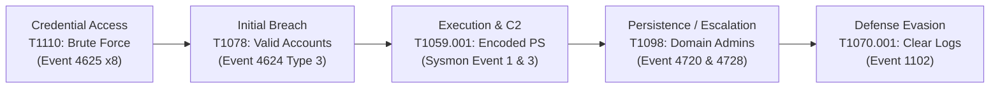

# Security Operations Center (SOC) Incident Investigation Report
## Incident ID: INC-20261025-003 | Critical Enterprise Intrusion & Domain Controller Compromise

---

| Incident Metadata | Information |
| :--- | :--- |
| **Incident ID** | `INC-20261025-003` |
| **Detection Timestamp** | 2026-10-25 14:11:05 UTC |
| **Lead SOC Analyst** | Osagie Henry Idehen |
| **Target Role Alignment**| Tier 1 / Tier 2 SOC Analyst • Threat Hunter • Detection Engineer |
| **Classification** | **True Positive — Multi-Stage Enterprise Domain Compromise** |
| **Threat Severity** | **CRITICAL** |
| **Incident Status** | **CONTAINED & CLOSED** |
| **Primary Target Host** | `DC-CORP-01.globaltech.corp` (Primary Domain Controller) |
| **Compromised Identity**| `GLOBALTECH\Administrator` |
| **Adversary Infrastructure**| `185.220.101.5` (Hostinger VPS / C2 Relay) |

---

## 1. Executive Summary

On October 25, 2026 at 14:10 UTC, the Splunk Enterprise SIEM triggered a high-severity alert indicating an aggressive authentication brute-force attempt targeting `DC-CORP-01` originating from external IP `185.220.101.5`. Within 63 seconds of brute-force initiation, the adversary successfully established a network logon (EventCode 4624, Logon Type 3) using compromised `Administrator` credentials.

Following successful authentication, the threat actor initiated a multi-stage intrusion:
1. **Command & Control Execution:** Spawned an obfuscated Base64-encoded reverse PowerShell shell connecting outbound over TCP 443 to `185.220.101.5`.
2. **Persistence & Privilege Escalation:** Created a rogue local/domain user account named `svc-backup-admin` and immediately assigned it to the `Domain Admins` global group (EventCode 4728).
3. **Payload Staging (LOLBAS):** Abused `certutil.exe` to download a secondary binary (`update_agent.exe`) from the adversary server to `C:\Windows\Temp\`.
4. **Anti-Forensics / Defense Evasion:** Cleared the Windows Security Audit Log (EventCode 1102) in an attempt to destroy investigation evidence.

**Containment Execution:** The SOC immediately executed emergency containment: isolated `DC-CORP-01` from network routing, disabled compromised and rogue accounts (`Administrator`, `svc-backup-admin`), executed a dual `krbtgt` password reset to invalidate active Kerberos tickets, and dropped `185.220.101.5` at the edge border firewall.

---

## 2. Attack Progression & MITRE ATT&CK Matrix



| Tactic | Technique ID | Technique Name | Telemetry Evidence |
| :--- | :--- | :--- | :--- |
| **Credential Access** | `T1110.001` | Password Guessing / Brute Force | 8 failed logons (4625) in 60s from `185.220.101.5` |
| **Initial Access** | `T1078` | Valid Accounts: Local / Domain Admin | Network logon (4624 Type 3) using `Administrator` |
| **Execution** | `T1059.001` | PowerShell: Encoded Command | `powershell.exe -nop -w hidden -enc JABj...` |
| **Command & Control** | `T1071.001` | Web Protocols: Port 443 | Outbound TCP connection to `185.220.101.5:443` |
| **Persistence** | `T1136.002` | Create Account: Domain Account | Created `svc-backup-admin` (Event 4720) |
| **Privilege Escalation**| `T1098` | Account Manipulation: Admin Group | Added `svc-backup-admin` to `Domain Admins` (Event 4728) |
| **Defense Evasion** | `T1105` | Ingress Tool Transfer (LOLBAS) | `certutil.exe -urlcache -split -f ... update_agent.exe` |
| **Defense Evasion** | `T1070.001` | Clear Windows Event Logs | Security log cleared by `svc-backup-admin` (Event 1102) |

---

## 3. Splunk Search Processing Language (SPL) Queries

### 3.1 Brute Force Threshold Alert
```spl
index=windows_security EventCode=4625
| stats count, values(user) as targeted_users, values(workstation) as workstations, values(sub_status) as failure_codes by src_ip
| where count >= 5
| eval risk_severity="HIGH", mitre_tactic="Credential Access (T1110)"
```

### 3.2 Breached Account Detection (Logon Success Post-Failures)
```spl
index=windows_security EventCode=4624 (Logon_Type=3 OR Logon_Type=10)
[ search index=windows_security EventCode=4625
  | stats count by src_ip
  | where count >= 3
  | fields src_ip ]
| table _time, computer_name, user, src_ip, logon_type
| eval alert="CRITICAL: Compromised Account Active Session", mitre_tactic="Initial Access (T1078)"
```

### 3.3 Obfuscated PowerShell & LOLBAS Ingress Hunting
```spl
index=sysmon EventCode=1
(Image="*\\powershell.exe" AND (CommandLine="*-enc*" OR CommandLine="*-w hidden*" OR CommandLine="*downloadstring*"))
OR (Image="*\\certutil.exe" AND CommandLine="*-urlcache*")
| table _time, computer_name, user, Image, CommandLine, ParentImage, Hashes
| eval alert="Suspicious LOLBAS Execution", mitre_tactic="Execution / Ingress (T1059 / T1105)"
```

### 3.4 Rogue Domain Admin Membership Detection
```spl
index=windows_security (EventCode=4728 OR EventCode=4732) (group_name="*Domain Admins*" OR group_name="*Enterprise Admins*")
| table _time, computer_name, subject_user_name, target_user_name, group_name
| eval alert="CRITICAL: Unauthorized Domain Admin Added", mitre_tactic="Privilege Escalation (T1098)"
```

---

## 4. Indicators of Compromise (IoCs) — Defanged

| IoC Type | Value | Defanged Value | Threat Context |
| :--- | :--- | :--- | :--- |
| **Adversary IPv4** | `185.220.101.5` | `185[.]220[.]101[.]5` | External attacker brute-force & C2 server |
| **Rogue Username** | `svc-backup-admin` | `svc-backup-admin` | Attacker backdoor added to Domain Admins |
| **Compromised User** | `Administrator` | `GLOBALTECH\Administrator` | Brute-forced enterprise administrator |
| **Payload File Path**| `C:\Windows\Temp\update_agent.exe` | `C:\Windows\Temp\update_agent[.]exe` | Staged binary downloaded via certutil |
| **Certutil SHA-256** | `106D44BC5BD52DC30B7EFEC0CD073CE1F8F128E619D7BB4BA16D713361E14B4B` | N/A | Process hash for certutil execution |
| **PowerShell SHA-256**| `852D0F88D0592F8E74FB191404C16F754714B970794E278B6D1B46AAEC52A3F3` | N/A | Process hash for encoded PowerShell |

---

## 5. Containment, Eradication & Recovery Playbook (NIST SP 800-61 Rev. 2)

### Step 1: Host Isolation & Active Session Termination
```powershell
# Immediately sever DC-CORP-01 non-essential network connections via EDR
Invoke-LimaCharlieCommand -SensorId "DC-CORP-01" -Command "isolate"

# Kill running adversary PowerShell and Certutil process trees
Get-Process powershell, certutil -ErrorAction SilentlyContinue | Stop-Process -Force
```

### Step 2: Identity Eradication & Account Remediation
```powershell
# Disable rogue backdoor account
Disable-ADAccount -Identity "svc-backup-admin"
Remove-ADGroupMember -Identity "Domain Admins" -Members "svc-backup-admin" -Confirm:$false
Remove-ADUser -Identity "svc-backup-admin" -Confirm:$false

# Force password reset for compromised built-in Administrator
Set-ADAccountPassword -Identity "Administrator" -Reset -NewPassword (ConvertTo-SecureString -AsPlainText "Temp#Hardened!P@ss2026" -Force)

# Perform dual KRBTGT password reset (10-hour interval recommended) to invalidate all active Kerberos TGT tickets
# Prevents Golden Ticket persistence attacks
.\Reset-KrbTgt-PasswordForGoldenTicketMitigation.ps1
```

### Step 3: Perimeter Defense & Threat Hunting Sweep
1. **Firewall Drop:** Block `185[.]220[.]101[.]5` permanently at all border firewalls.
2. **SIEM Telemetry Sweep:** Execute 30-day historical search across all endpoints for any process referencing `update_agent.exe` or connection to port 443 on `185[.]220[.]101[.]5`.
3. **Artifact Deletion:** Purge `C:\Windows\Temp\update_agent.exe` and collect forensic memory image for reverse-engineering.

---

## 6. Strategic Post-Incident Recommendations

1. **Disable Network Exposure of Domain Controllers:** Disallow direct external RDP (3389) and SMB (445) connections; mandate zero-trust VPN or Azure Bastion with MFA.
2. **Implement Account Lockout Thresholds:** Configure Active Directory Group Policy to lock accounts after 5 consecutive failures for a minimum of 30 minutes.
3. **Deploy Tiered Administration (PAW / Tier 0 Architecture):** Restrict Domain Admin accounts from logging onto non-Domain Controller systems to thwart credential theft.
4. **Enable Real-Time Splunk SOC Alerting:** Operationalize `savedsearches.conf` to trigger automated webhook notifications to the on-call SOC analyst upon Event 4728 or 1102.

---
*Report certified and closed by: **Osagie Henry Idehen, CompTIA Security+ Certified SOC Analyst**.*
